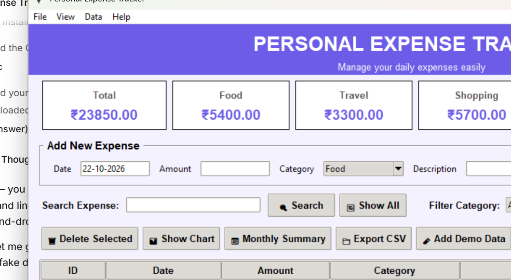
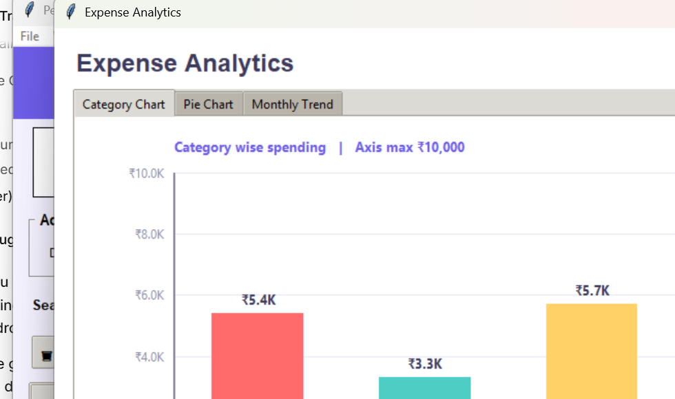
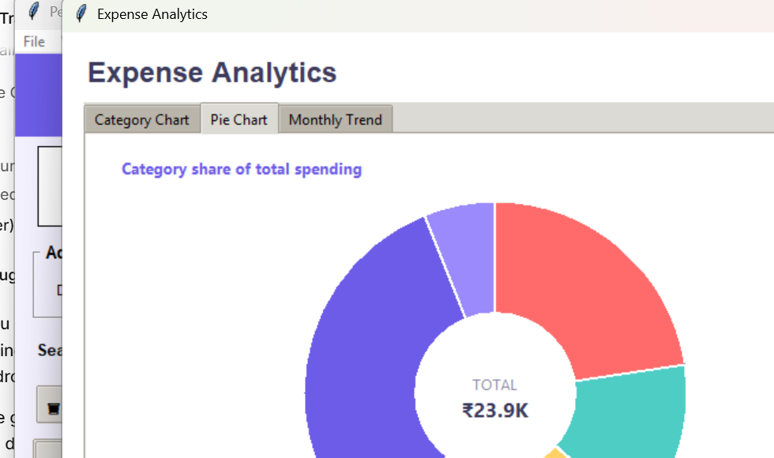
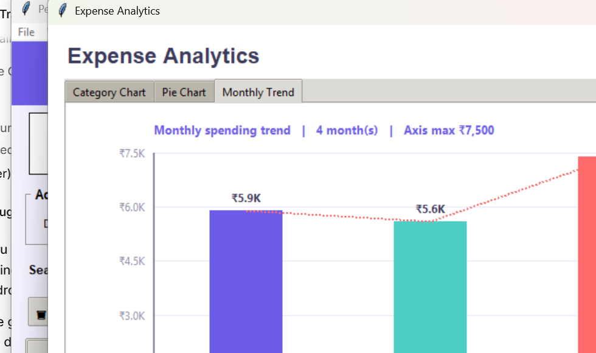

# 💰 Personal Expense Tracker

A desktop expense tracker built with **Python + Tkinter**, with a built-in
charting engine that draws **category bar charts, pie charts and monthly
trend charts** using nothing but the Tkinter `Canvas` — no matplotlib, no
Pillow, no external dependencies.



## ✨ Features

- **Add expenses** with date, amount, category and description (with full validation)
- **Live category totals** in the summary cards (Total / Food / Travel / Shopping / Fees / Others)
- **Search** across every field, plus a **category filter**
- **Delete** a selected row or **clear** everything
- **Export to CSV** for use in Excel or Google Sheets
- **Add demo data** with one click to try the app instantly
- **Monthly summary** dialog

### 📊 Charts

| Category chart | Pie chart |
|---|---|
|  |  |



- Three tabs: **Category Chart**, **Pie Chart**, **Monthly Trend**
- Real axes with grid lines and ₹ scale labels
- Value and percentage labels on every bar
- **Log scale** toggle so small categories stay readable when one category dominates
- **Use current filter / search** toggle so charts follow the table
- Charts redraw automatically on window resize and whenever the data changes
- Charts stay inside the visible screen area, even on small laptop displays

## ✅ Requirements

- Python 3.8 or newer
- Tkinter (included with the standard Python installer on Windows)

No `pip install` needed — everything used is in the standard library.

## 🚀 How to run

```bash
python app.py
```

Or in **VS Code**: open `app.py` and press `F5`.

The database file `expenses.db` is created automatically next to `app.py`
on first launch.

## ⌨️ Keyboard shortcuts

| Shortcut | Action |
|---|---|
| `Ctrl + G` | Open the chart window |
| `Ctrl + M` | Monthly summary |
| `F5` | Refresh the table |

Shortcuts work while the app window has focus. The same actions are also
available from the toolbar buttons and the `View` menu.

## 📁 Project structure

```
expense-tracker/
├── app.py               # entire application (UI, database, charts)
├── diagnose.py          # optional troubleshooting helper
├── .gitignore
└── screenshots/
```

## 🗄️ Database

A single SQLite table, created automatically:

```sql
CREATE TABLE expenses (
    id          INTEGER PRIMARY KEY AUTOINCREMENT,
    date        TEXT NOT NULL,   -- DD-MM-YYYY
    amount      REAL NOT NULL,
    category    TEXT NOT NULL,
    description TEXT NOT NULL
);
```

The database file is **not** committed to this repository.

## 🐛 Troubleshooting

If the chart window does not appear, run:

```bash
python diagnose.py
```

It prints your screen size, Tk version, DPI awareness and the state of every
chart canvas, and writes the same report to `diagnose_report.txt`.

Any chart drawing error is written to `chart_debug.log` and displayed on the
chart canvas instead of leaving a blank window.

## 📄 License

No license specified — all rights reserved.
